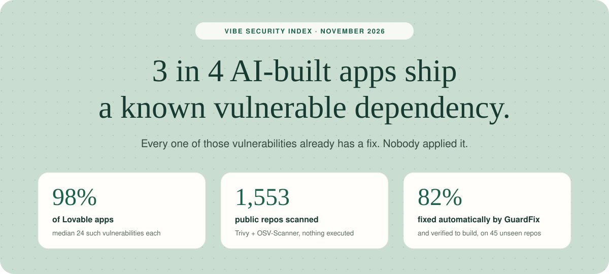
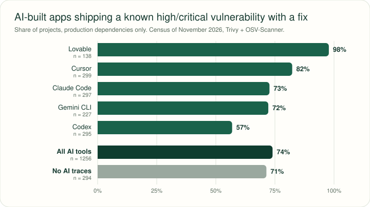

<picture>
  <source media="(prefers-color-scheme: dark)" srcset="assets/hero-dark.svg">
  
</picture>

<p align="center">
  <a href="#the-numbers">The numbers</a> ·
  <a href="#check-your-own-app-in-a-minute">Check your app</a> ·
  <a href="#why-nobody-applies-the-fix">Why nobody fixes it</a> ·
  <a href="METHODOLOGY.md">Method</a> ·
  <a href="README.ru.md">Русский</a>
</p>

# Vibe Security Index

We scanned **1,553 public GitHub projects** built with Lovable, Cursor, Claude Code, Gemini CLI and Codex, plus a control group with no AI traces.

**74% of the AI-built ones ship a production dependency with a known high or critical vulnerability. For Lovable apps it is 98%.** Every vulnerability counted here already has a patched version. It was published, and nobody installed it.

This is not a story about AI writing bad code. It is a story about apps that get generated, deployed and never updated again. Attackers do not need to find a new bug in your app. Scanners that try known CVEs against every site on the internet run all day.

## The numbers

<picture>
  <source media="(prefers-color-scheme: dark)" srcset="assets/chart-dark.svg">
  
</picture>

| Built with | Projects | Ship a known high/critical vuln with a fix | Share | Median such vulns per project |
|---|---:|---:|---:|---:|
| Lovable | 138 | 135 | **98%** | 24 |
| Cursor | 299 | 246 | **82%** | 26 |
| Claude Code | 297 | 216 | **73%** | 11 |
| Gemini CLI | 227 | 164 | **72%** | 15 |
| Codex | 295 | 168 | **57%** | 3 |
| **All AI tools** | **1,256** | **929** | **74%** | 15 |
| No AI traces (control) | 294 | 210 | **71%** | 10 |

Bolt had only 3 eligible public projects and is left out of the comparison. Full tables: [`data/summary.csv`](data/summary.csv), [`data/by_severity.csv`](data/by_severity.csv), [`data/by_manager.csv`](data/by_manager.csv).

**Three things stand out:**

1. **Tools for beginners are hit hardest.** Lovable at 98%, and the median Lovable app carries 24 such vulnerabilities. People who never open `package.json` never update it.
2. **It is not buried deep.** In 86% of Lovable projects (55% overall) at least one of these vulnerabilities is in a direct dependency, a package listed right in `package.json`.
3. **Projects without AI are not much better** (71%). The problem is that nobody maintains dependencies, and AI tools have made it very easy to ship apps nobody maintains.

## Check your own app in a minute

**In one command (free, runs locally):** `npx guardfix` in your project folder. It gives a grade, the version to upgrade each package to, and a prompt for Claude Code, Cursor or Codex to fix it. [More](https://github.com/guardfix/guardfix).

**With GuardFix (free):** [guardfix.io](https://guardfix.io). Connect a repository and get the same check, plus a pull request that upgrades the vulnerable packages and proves the app still installs and builds.

**Yourself, with the same open scanner we used:**

```sh
# in your project folder; reads lockfiles only, runs nothing
docker run --rm -v "$PWD":/src aquasec/trivy:0.76.1 fs --scanners vuln --severity HIGH,CRITICAL --ignore-unfixed /src
```

Anything it prints is a known vulnerability with a fixed version available: the same thing this index counts (the index also skips dev-only dependencies).

## Why nobody applies the fix

Bumping a version is easy. Making sure nothing broke is not. The new version can change an API or pull in other upgrades, and the lockfile has to be regenerated with the right package manager. A vibe-coded app usually has no tests to tell you whether it still works.

That gap is what we build at **[GuardFix](https://guardfix.io)**. The agent upgrades the dependency, then reinstalls the project from scratch in a sandbox, rescans it with two scanners, builds it and runs its tests. Only then does it open a pull request. On 45 projects from this index that it had never seen, **138 of 169 fixes (82%) passed that verification.**

## What this does and does not say

- **It does** show that known, already patched vulnerabilities are the norm in public AI-built apps.
- **It does not** prove that each one is exploitable. A vulnerable version in a lockfile does not mean the vulnerable code path is reachable.
- **It does not** say that AI writes less secure code. The control group is close behind.

## Method in three lines

1. **Finding projects.** We used GitHub search on the trace each tool leaves in a repository, one tool per project:
   - Lovable: `lovable-tagger` or Lovable's README;
   - Cursor: `.cursor/rules`;
   - Claude Code: `Co-authored-by: Claude` commits;
   - Codex: merged PRs from `codex/` branches;
   - Gemini CLI: `GEMINI.md`.

   Filters for every project: 3–1,000 stars, created in 2025 or later, at least 10 commits.
2. **Scanning.** We shallow-cloned the latest commit and scanned the lockfiles with Trivy 0.76.1 and OSV-Scanner 2.7.0. Nothing was installed, built or run.
3. **Counting.** A project counts if it has at least one high or critical advisory for an exact locked version of a production dependency, with a fixed version available.

Details, filters and known biases are in [METHODOLOGY.md](METHODOLOGY.md). Limits: public repositories only; tool attribution is a heuristic; the data is a snapshot. Advisories published after the census are not counted.

## Reproduce

```sh
cd scripts
GITHUB_TOKEN=<your token> python collect.py --per-group 300 --out projects.json
python scan.py projects.json results.jsonl --workers 3
python aggregate.py results.jsonl projects.json --out ../data
python chart.py
```

GitHub search and vulnerability databases change daily, so a rerun gives similar numbers, not identical ones. We publish aggregates only, never a list of vulnerable projects. See [scripts/README.md](scripts/README.md).

## License and citation

Code (`scripts/`): [Apache-2.0](LICENSE). Data and charts (`data/`, `assets/`): [CC BY 4.0](data/LICENSE). Heading font: Source Serif 4, SIL OFL.

Cite as: *GuardFix Vibe Security Index, November 2026.*
