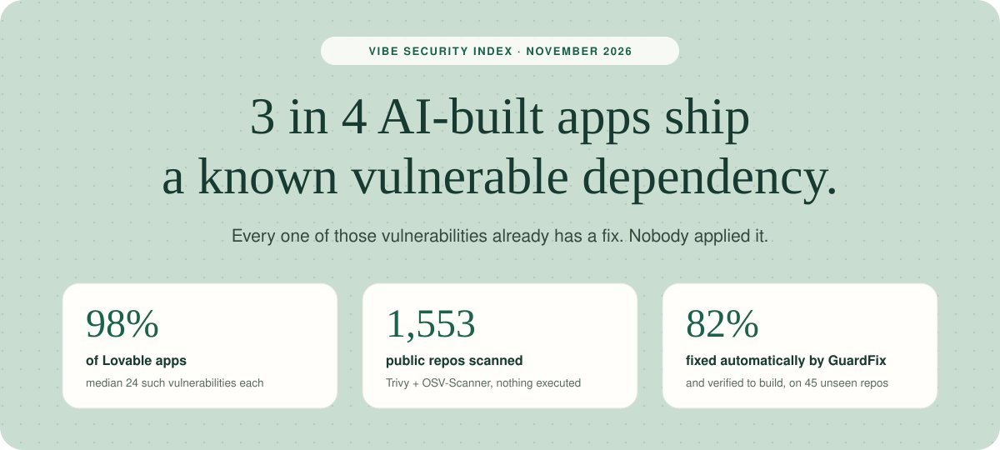
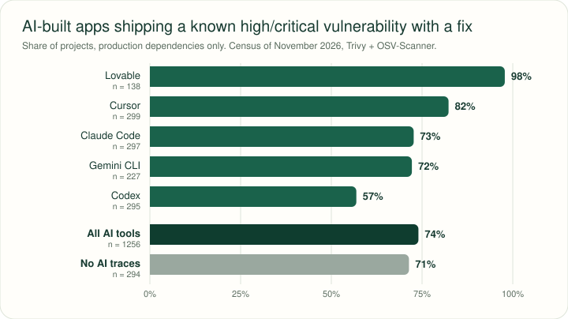

<picture>
  <source media="(prefers-color-scheme: dark)" srcset="assets/hero-dark.svg">
  
</picture>

<p align="center"><a href="README.md">English</a> · <a href="METHODOLOGY.md">Методика (англ.)</a></p>

# Vibe Security Index

Мы проверили **1553 открытых проекта на GitHub**, сделанных в Lovable, Cursor, Claude Code, Gemini CLI и Codex. Для сравнения взяли контрольную группу без следов ИИ.

**У 74% проектов, сделанных с ИИ, в рабочих зависимостях есть известная серьёзная уязвимость (high или critical). У приложений из Lovable — у 98%.** Для каждой посчитанной уязвимости исправленная версия уже вышла. Её просто никто не поставил.

Дело не в том, что ИИ пишет плохой код. Приложение сгенерировали, выложили и больше никогда не обновляли. Взломщику не нужно искать в нём новую дыру: автоматические сканеры круглые сутки пробуют известные уязвимости на всех сайтах подряд.

## Цифры

<picture>
  <source media="(prefers-color-scheme: dark)" srcset="assets/chart-dark.svg">
  
</picture>

| Сделано в | Проектов | С серьёзной уязвимостью, у которой есть исправление | Доля | Медиана таких уязвимостей на проект |
|---|---:|---:|---:|---:|
| Lovable | 138 | 135 | **98%** | 24 |
| Cursor | 299 | 246 | **82%** | 26 |
| Claude Code | 297 | 216 | **73%** | 11 |
| Gemini CLI | 227 | 164 | **72%** | 15 |
| Codex | 295 | 168 | **57%** | 3 |
| **Все с ИИ** | **1256** | **929** | **74%** | 15 |
| Без следов ИИ (контроль) | 294 | 210 | **71%** | 10 |

Bolt не сравниваем: подходящих открытых проектов нашлось всего 3.

**Главное:**
1. **Сильнее всего страдают инструменты для новичков.** В Lovable 98%, в среднем приложении 24 такие уязвимости. Кто не открывает `package.json`, тот его и не обновляет.
2. **Уязвимости лежат на поверхности.** В 86% проектов Lovable (55% в среднем) хотя бы одна из них в прямой зависимости, то есть в пакете, который прямо указан в `package.json`.
3. **Без ИИ ненамного лучше (71%).** Проблема в том, что зависимости никто не обновляет. ИИ просто сделал очень лёгким выпуск приложений, которые никто не поддерживает.

## Проверить своё приложение за минуту

**Одной командой (бесплатно, всё у вас на компьютере):** `npx guardfix` в папке проекта. Покажет оценку, до какой версии обновить каждый пакет, и готовый промпт для Claude Code, Cursor или Codex. [Подробнее](https://github.com/guardfix/guardfix).

**В GuardFix бесплатно:** [guardfix.io](https://guardfix.io). Подключаете репозиторий и получаете ту же проверку и pull request: он обновляет уязвимые пакеты и доказывает, что приложение по-прежнему ставится и собирается.

**Самостоятельно, тем же открытым сканером:**

```sh
# в папке проекта; читает только lock-файлы, ничего не запускает
docker run --rm -v "$PWD":/src aquasec/trivy:0.76.1 fs --scanners vuln --severity HIGH,CRITICAL --ignore-unfixed /src
```

## Почему исправление никто не ставит

Поднять версию просто. Сложно убедиться, что ничего не сломалось. Новая версия может изменить API и потянуть за собой другие обновления. Lock-файл нужно пересобрать нужным менеджером пакетов. А тестов, которые скажут, работает ли приложение, у вайб-проекта обычно нет.

Эту часть и закрывает **[GuardFix](https://guardfix.io)**. Агент обновляет зависимость и в песочнице заново ставит проект с нуля. Потом проверяет его двумя сканерами, собирает и прогоняет тесты. Только после этого открывает pull request. На 45 проектах из этого индекса, которых агент раньше не видел, проверку прошли **138 исправлений из 169 (82%)**.

## Что это значит и чего не значит

- Известные и уже исправленные уязвимости в открытых ИИ-приложениях — норма.
- Это не доказательство, что каждую можно использовать: уязвимая версия в lock-файле не значит, что уязвимый код вызывается.
- Это не значит, что ИИ пишет опаснее людей: контрольная группа отстаёт ненамного.

Как искали и считали, ограничения и перекосы выборки: [METHODOLOGY.md](METHODOLOGY.md). Публикуем только общие цифры, списка уязвимых проектов нет. Повторить: [scripts/README.md](scripts/README.md).

Код: Apache-2.0. Данные и графики: CC BY 4.0. Шрифт заголовков: Source Serif 4, SIL OFL.
